<!-- ═════════════════════ ABOVE THE GRAY FOG ═════════════════════ -->


<p align="center">
  <a href="https://github.com/truvch">
    
  </a>
</p>

<p align="center">
  
  <a href="https://linkedin.com/in/aaron-angon"></a>
  <a href="mailto:angonaaron7@gmail.com"></a>
</p>

<p align="center"><sub>✦ ─────────── ✦ ─────────── ✦ ─────────── ✦</sub></p>

### 📜 `Dossier of the Beyonder`

```ts
// Filed by the Nighthawks — Pasig Division. Classification: Mildly Dangerous.
const beyonder = {
  name:         "Aaron Angon",
  residence:    "Pasig, Philippines 🇵🇭",
  affiliation:  "Mapúa University — Computer Science",
  pathway:      "Full-Stack",
  sequence:     "9 — Apprentice of the Web (potion still digesting)",
  sealedArtifacts: {
    frontend: ["React", "TypeScript", "Tailwind", "Bootstrap"],
    backend:  ["Node.js", "Express", "Flask", "Python"],
    vaults:   ["MongoDB", "SQLite"],
  },
  actingMethod: "build things, break things, learn from both",
  sideEffects:  ["3 AM debugging", "hearing whispers from the console"],
  warning:      "do not chant this user's name three times near production",
  correspondence: "angonaaron7@gmail.com",
};
```

<p align="center"><sub>✦ ─────────── ✦ ─────────── ✦ ─────────── ✦</sub></p>

### ⚗️ `Potion Formula — Main Ingredients`

<p align="center">
  <br/>
  
</p>

<p align="center"><sub><i>Supplementary ingredient: an unreasonable amount of coffee.</i></sub></p>

<p align="center"><sub>✦ ─────────── ✦ ─────────── ✦ ─────────── ✦</sub></p>

### 🔮 `Results of the Divination`

<p align="center">
  
  
</p>

<p align="center">
  
</p>

<p align="center">
  
</p>

<p align="center"><sub>✦ ─────────── ✦ ─────────── ✦ ─────────── ✦</sub></p>

### 🐍 `The Serpent of Fate Devours the Calendar`

<p align="center">
  <picture>
    <source media="(prefers-color-scheme: dark)" srcset="https://raw.githubusercontent.com/truvch/truvch/output/github-snake-dark.svg" />
    <source media="(prefers-color-scheme: light)" srcset="https://raw.githubusercontent.com/truvch/truvch/output/github-snake.svg" />
    
  </picture>
</p>

<p align="center"><sub>✦ ─────────── ✦ ─────────── ✦ ─────────── ✦</sub></p>

### 🃏 `Current Undertakings`

| | Codename | Status |
|:-:|---|---|
| 🔒 | *[Sealed Artifact]* | Under study behind closed doors. Contents classified until further notice. |
| 🚌 | **PasigCommutr** | To be released to the public in early 2027. Pasig's scattered transport routes, gathered into one place. |

<br/>

<p align="center">
  <i>"First, solve the problem. Then, write the code."</i><br/>
  <sub>🕯️ The Tarot Club convenes every Monday at 3 PM. Leave a ⭐ as your offering.</sub>
</p>

<!-- ═════════════════════ RETURN TO REALITY ═════════════════════ -->


